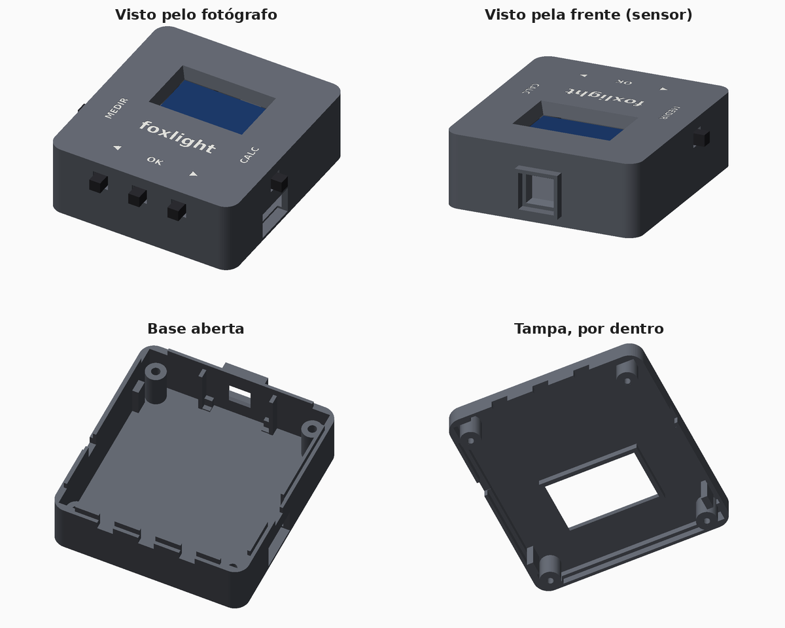
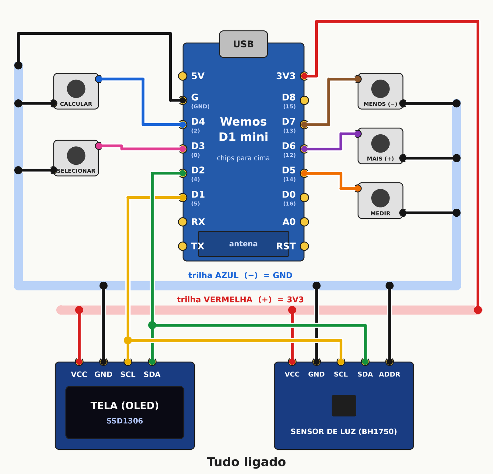
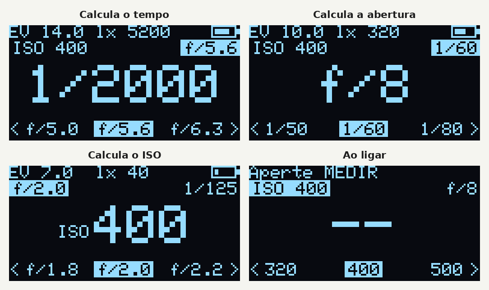
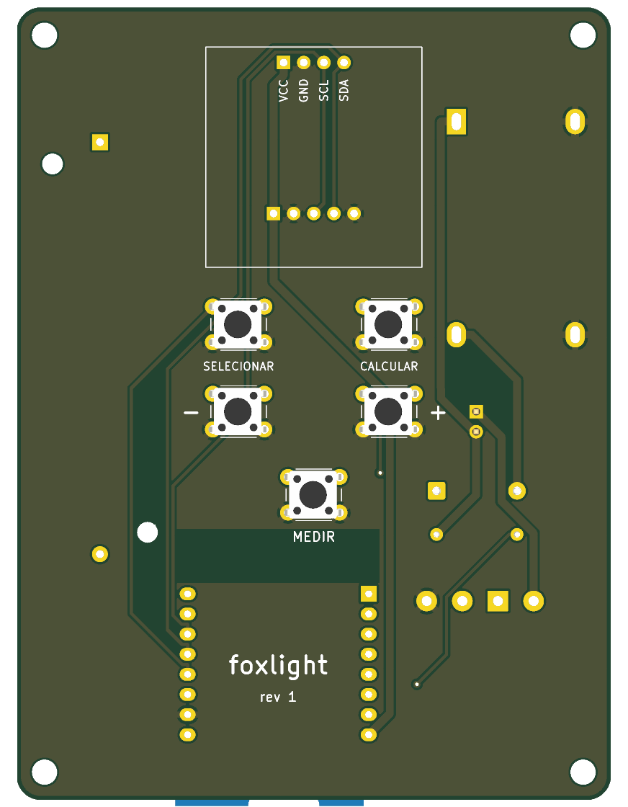
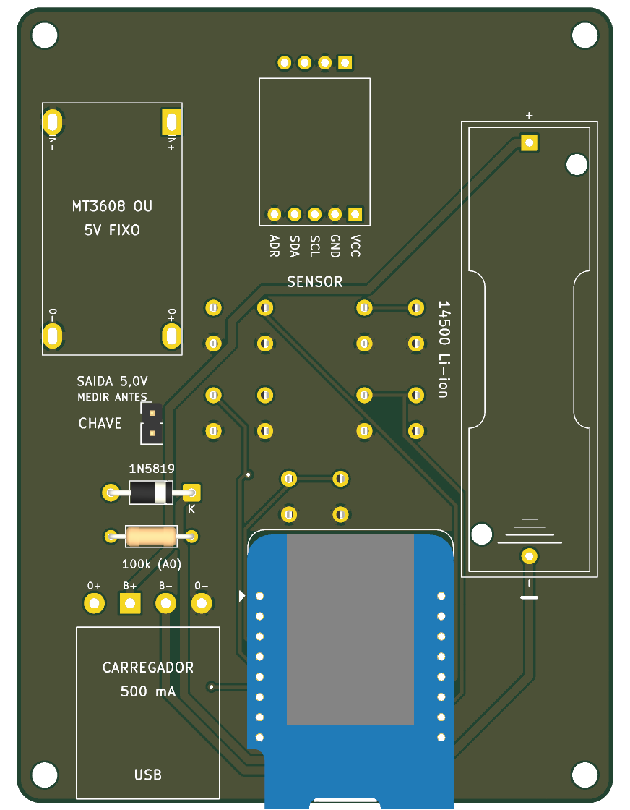
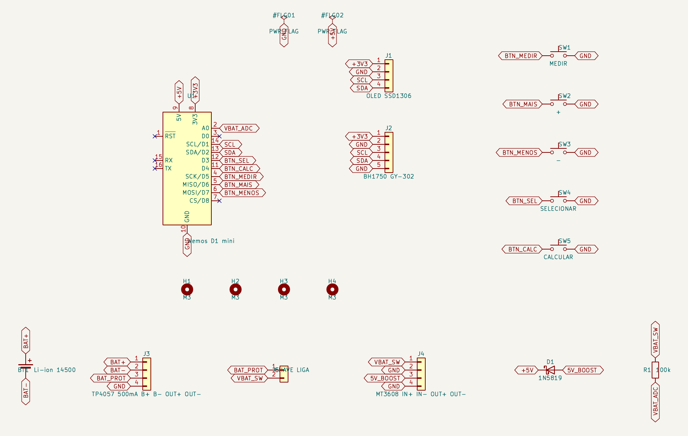

# foxlight

Fotômetro refletido para fotografia analógica. Você define dois valores entre
**ISO**, **abertura** e **tempo**; o medidor calcula o terceiro.

| Versão | Cérebro | Para quê | Documentação |
| ------ | ------- | -------- | ------------ |
| Protoboard e **rev 1** | Wemos D1 mini (ESP8266) | bancada, alimentação por USB | este arquivo e [montagem](docs/MONTAGEM.md) |
| **rev 2** | Seeed XIAO ESP32C6 | compacto, sapata da câmera, bateria | [docs/REV2.md](docs/REV2.md) |

O mesmo firmware serve as duas.

> [!WARNING]
> **Trabalho em progresso.** Use por sua conta e risco.
>
> | Parte | Situação |
> | ----- | -------- |
> | Firmware na D1 mini, em protoboard | tela, sensor e botões funcionando na primeira versão; a tela nova ainda não foi gravada nela |
> | Calibração contra um fotômetro de referência | **não feita**: não confie nas leituras para expor filme |
> | Firmware na XIAO ESP32C6 | **só compilado**, nunca rodou na placa |
> | Placas rev 1 e rev 2 | **nunca fabricadas**; passam no DRC, mas várias medidas de módulos são estimadas |
> | Caixa da rev 2 | **nunca impressa** |
> | Bateria e alimentação | **nunca montadas nem testadas** |



## Recursos

- Medição de luz refletida, sem difusor, com o sensor apontado para a cena.
- Calcula tempo, abertura ou ISO, em passos de 1/3 de stop.
- ISO 6 a 25600, f/1.0 a f/64, 30 s a 1/8000 (tempos mais longos também aparecem).
- Medição contínua enquanto o botão é segurado.
- Faixa estendida: ajusta a sensibilidade do sensor em luz forte e fraca.
- Lux e EV na tela; configurações salvas na memória.
- Na rev 2: dorme sozinho, acorda no botão Medir e mostra a carga da bateria.

## Peças (protoboard)

Para a versão compacta, ver [docs/REV2.md](docs/REV2.md#peças).

| Qtd | Peça |
| --- | ---- |
| 1 | Wemos D1 mini ou clone (HW-386, USB-C) |
| 1 | Sensor BH1750 (GY-302), sem difusor |
| 1 | OLED SSD1306 128x64 I2C, 0,96" |
| 5 | Botões táteis 6x6 mm |

Em protoboard, a alimentação é pelo USB da placa. A placa rev 1 tem lugar para
bateria (ver [Placa rev 1](#placa-rev-1)).

## Ligações (D1 mini)

**Guia ilustrado, um passo de cada vez: [docs/MONTAGEM.md](docs/MONTAGEM.md).**

[](docs/MONTAGEM.md)

| D1 mini | Liga em |
| ------- | ------- |
| 3V3 | VCC do OLED e do BH1750 |
| GND | GND do OLED, do BH1750, ADDR do BH1750 e um lado de cada botão |
| D1 | SCL do OLED e do BH1750 |
| D2 | SDA do OLED e do BH1750 |
| D5 | botão **Medir** |
| D6 | botão **+** |
| D7 | botão **−** |
| D3 | botão **Selecionar** |
| D4 | botão **Calcular** |

Cada botão fica entre o pino e o GND, sem resistor. Não segure **Selecionar**
nem **Calcular** ao ligar: D3 e D4 definem o modo de boot do ESP8266.

Confira a ordem dos pinos na serigrafia de cada módulo. No OLED usado aqui é
`VCC GND SCL SDA`; no GY-302 costuma ser `VCC GND SCL SDA ADDR`.

## Uso

| Botão | Ação |
| ----- | ---- |
| Medir | faz uma leitura; segurando, mede continuamente |
| Calcular | escolhe a incógnita: tempo → abertura → ISO |
| Selecionar (**OK** na rev 2) | troca qual dos dois valores definidos será alterado |
| + / − (**►** / **◄** na rev 2) | altera o valor selecionado em 1/3 de stop; segurando, repete |



De cima para baixo: EV (ISO 100), lux e bateria; os dois valores definidos, com o
selecionado destacado; o resultado em letras grandes; e a régua do valor
selecionado, com o anterior e o próximo. Mudar um valor recalcula na hora com a
última leitura. As configurações são salvas 2 s depois da última mudança.

Resultados fora da escala aparecem como `<1.0`, `>64`, `<6`, `>25600` ou
`<1/8000`. Exposições além de 30 s mostram o tempo (`64s`, `2.1m`, `2h`), sem
correção de reciprocidade.

## Compilar e gravar

D1 mini (para a XIAO ESP32C6, ver [docs/REV2.md](docs/REV2.md#gravar)):

```bash
arduino-cli core install esp8266:esp8266 --additional-urls http://arduino.esp8266.com/stable/package_esp8266com_index.json
arduino-cli lib install "Adafruit GFX Library" "Adafruit SSD1306" BH1750
arduino-cli compile --fqbn esp8266:esp8266:d1_mini src/foxlight
arduino-cli upload  --fqbn esp8266:esp8266:d1_mini -p /dev/ttyUSB0 src/foxlight
```

Para conferir a montagem:

- `tools/i2c_scan` lista o barramento: devem aparecer `0x23` e `0x3C` (serial a 115200).
- `tools/button_test` mostra na tela o estado de cada botão.

Testes da matemática, no PC:

```bash
g++ -std=c++11 -Wall -Wextra -o /tmp/exposure_test test/exposure_test.cpp && /tmp/exposure_test
```

## Cálculo

```
EV100 = log2(lux * 100 / (Ω * K))      Ω = 2,53 sr, K = 12,5
abertura + tempo = EV100 + ISO         (escala APEX, em terços de stop)
```

- `K` é a constante de fotômetro refletido (ISO 2720).
- `Ω` é o ângulo sólido efetivo do BH1750 nu, obtido integrando as curvas de
  direcionalidade do [datasheet](https://wemos-docs.readthedocs.io/en/latest/_static/files/bh1750fvi-tr.pdf)
  (figs. 4 e 5).
- Isso supõe uma cena uniforme preenchendo o campo do sensor.

A fórmula `log2(lux / 2,5)`, comum em projetos com BH1750, é a de luz
**incidente**. Com o sensor apontado para a cena ela erra em cerca de 3 stops.

## Limitações

- Campo de visão muito largo (resposta cai à metade perto de ±50°). Céu ou uma
  lâmpada na borda alteram a leitura. Aproxime-se do assunto ou incline o
  aparelho um pouco para baixo. Um tubo na frente do sensor estreita o campo,
  mas exige recalibrar.
- O datasheet admite ±20% de variação entre sensores (cerca de 0,3 stop), e a
  resposta muda com o tipo de lâmpada.
- Não mede flash.
- A carga da bateria (só na rev 2) é uma estimativa pela tensão.

## Calibração

1. Aponte o foxlight e uma câmera com fotômetro para a mesma parede lisa, bem
   iluminada por igual, preenchendo o campo dos dois.
2. Use o mesmo ISO e abertura e compare os tempos.
3. Se o foxlight indicar um tempo N stops **mais rápido** que a câmera, use
   `CALIBRATION = 2^-N`; se mais lento, `2^N`. Em terços: 0,79 / 1,26.
4. Edite `CALIBRATION` em `src/foxlight/foxlight.ino` e grave de novo.

## Placa rev 1

| Frente | Verso |
| :----: | :---: |
|  |  |

*Imagens geradas pelo KiCad. Os módulos sem modelo 3D aparecem só como contorno.*

Projeto KiCad em [`hardware/kicad_rev1/`](hardware/kicad_rev1/), dupla face, 75 x 100 mm,
só componentes THT. Frente: tela e botões. Verso: sensor, D1 mini, bateria,
carregador e conversor. Gerbers em
[`hardware/foxlight_rev1_gerbers.zip`](hardware/foxlight_rev1_gerbers.zip).



> [!CAUTION]
> **Não mande fabricar sem conferir.** Contornos e furos do OLED, do GY-302 e do
> MT3608 foram estimados por foto. Imprima os moldes
> [da frente](hardware/imagens/rev1_molde_frente_1x1.pdf) e
> [do verso](hardware/imagens/rev1_molde_verso_1x1.pdf) em escala 100% e encoste os
> módulos no papel. Confira também o suporte da pilha.

| Ref | Peça |
| --- | ---- |
| U1 | Wemos D1 mini (2 barras fêmea 1x8, opcional) |
| J1 | OLED SSD1306 0,96" I2C |
| J2 | GY-302 BH1750 |
| J3 | Carregador de **500 mA com proteção** (por exemplo TP4057, pads B+ B− OUT+ OUT−), até 18 x 22 mm, preso com fita e ligado por fios |
| J4 | Elevador para 5 V: MT3608 soldado direto, ou módulo de saída fixa (até 17 x 22 mm) ligado por fios |
| J5 | Chave liga/desliga externa, 2 fios |
| BT1 | Suporte AA Keystone 2460 (51,99 mm entre pinos) + célula 14500 Li-ion |
| D1 | Diodo Schottky 1N5819 |
| R1 | Resistor 100 k (bateria no A0; o firmware ainda não lê) |
| SW1–SW5 | Botão tátil 6x6 mm, altura 9,5 mm |
| H1–H4 | Parafusos M3 |

### Montagem da parte de energia

Baterias de lítio podem pegar fogo se carregadas ou ligadas de forma errada.

1. **Use um carregador de 500 mA.** Os módulos TP4056 comuns carregam a 1 A,
   demais para uma 14500. O chip TP4057 é limitado a 500 mA: o CI principal tem
   6 pernas (SOT-23-6), e não 8 como o TP4056. O módulo precisa ter também o
   circuito de proteção (saídas OUT+ e OUT− separadas de B+ e B−). Há anúncios
   confusos, então **meça a corrente** na primeira carga.
2. **Confira os 5 V antes de encaixar o D1 mini.** Com a pilha, sem o D1 mini e
   com a chave ligada, meça OUT+ do conversor. No MT3608, gire o trimpot até
   5,0 V (ele pode sair com quase 30 V). Módulo de saída fixa só precisa ser
   medido.
3. **Não use o USB do conversor,** se ele tiver: está ligado direto na entrada.
4. **Chave desligada** ao ligar o USB do D1 mini e durante a carga.
5. Confira a polaridade da pilha. Invertida, pode queimar o carregador.

## Estrutura

```
src/foxlight/     firmware (foxlight.ino), pinos (board.h), exposição e bateria
test/             testes da matemática, rodam no PC
docs/             guia de montagem na protoboard e documentação da rev 2
tools/            testes de bancada e geradores dos desenhos, da tela e da caixa
hardware/         projetos KiCad, gerbers, caixa 3D, imagens e moldes 1:1
```

## Referências

Projetos consultados para conferir os cálculos. Nenhum código deles está neste
repositório.

| Projeto | Consultado para |
| ------- | --------------- |
| [addrummond/mlm](https://github.com/addrummond/mlm) | conversão de lux para EV refletido |
| [m3_lightmeter](https://github.com/ScaredCube/m3_lightmeter) | pares de exposição como deslocamento em passos de stop |
| [oleksiikutuzov/flipperzero-lightmeter](https://github.com/oleksiikutuzov/flipperzero-lightmeter) | uso do BH1750 |
| [vpominchuk/lightmeter](https://github.com/vpominchuk/lightmeter) | referência de fotômetro com BH1750 |
| [Seeed-Studio/OPL_Kicad_Library](https://github.com/Seeed-Studio/OPL_Kicad_Library) | posição dos pinos e dos pads de bateria da XIAO |

O firmware usa as bibliotecas [BH1750](https://github.com/claws/BH1750),
Adafruit GFX e Adafruit SSD1306, cada uma sob a própria licença.

## Autor e licença

Autor: [Rômulo](https://github.com/romulofer).

Livre para uso **não comercial**, sob
[Creative Commons Attribution-NonCommercial 4.0](LICENSE) (CC BY-NC 4.0): pode
usar, modificar e compartilhar, citando o autor. Uso comercial só com
autorização.

Os footprints da biblioteca oficial do KiCad usados na placa seguem a licença
deles (CC BY-SA 4.0 com exceção para projetos).
