# Montagem na protoboard, passo a passo

Guia para a placa **Wemos D1 mini**. A versão compacta está em
[REV2.md](REV2.md).

Siga **um passo de cada vez**. Em cada desenho, os fios **coloridos e numerados**
são os que você liga agora. Os fios cinza você já ligou.

> [!IMPORTANT]
> - **Cabo USB desligado** sempre que for mexer nos fios.
> - Se algo esquentar ou cheirar a queimado, **tire o USB na hora**.
> - Criança monta com um adulto por perto.

## O que separar

- [ ] 1 placa Wemos D1 mini (com os pinos já soldados)
- [ ] 1 tela OLED SSD1306 de 4 pinos
- [ ] 1 sensor de luz BH1750 (módulo GY-302)
- [ ] 5 botões pequenos
- [ ] 1 protoboard
- [ ] 21 fios (jumpers): se puder, nas mesmas cores dos desenhos
- [ ] 1 cabo USB-C

A cor do fio é só para ajudar. O que importa é **onde cada ponta entra**.

## Antes de começar: duas coisas para entender

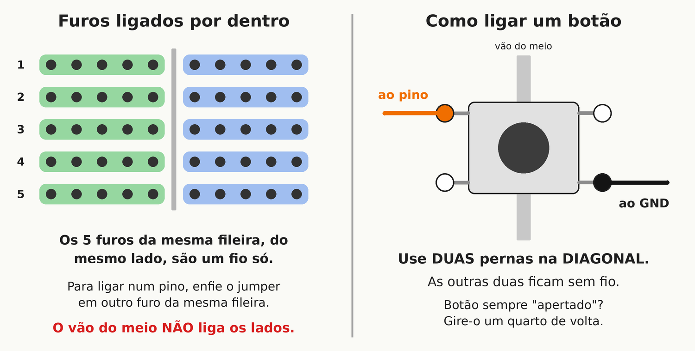

**Trilhas** são as duas linhas compridas na beirada da protoboard. A **azul (−)**
vai ser o GND e a **vermelha (+)** vai ser o 3V3. Em muitas protoboards há
trilhas dos dois lados, ou cortadas no meio. Para virarem uma só, ligue com um
fio **azul com azul** e **vermelha com vermelha**. **Nunca azul com vermelha:**
isso é um curto.

**A placa:** coloque-a atravessada no vão do meio, com o **USB para cima** e os
**chips virados para você**. Os nomes dos pinos podem estar escritos no verso,
às vezes só como número (o número pequeno entre parênteses nos desenhos).
Lembre que, olhando o verso, esquerda e direita trocam de lugar.

**Tela e sensor:** encaixe cada um com os pinos em fileiras diferentes. Leia os
nomes escritos neles, porque a **ordem pode mudar** de um fabricante para outro.
Siga o nome, não a posição.

## Como fica no final

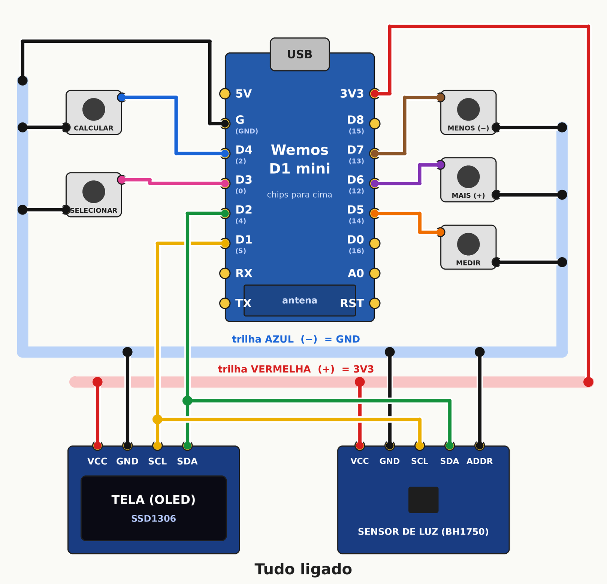

Onde dois fios se cruzam **sem bolinha**, eles **não se tocam**.

---

## Passo 1: o fio do GND

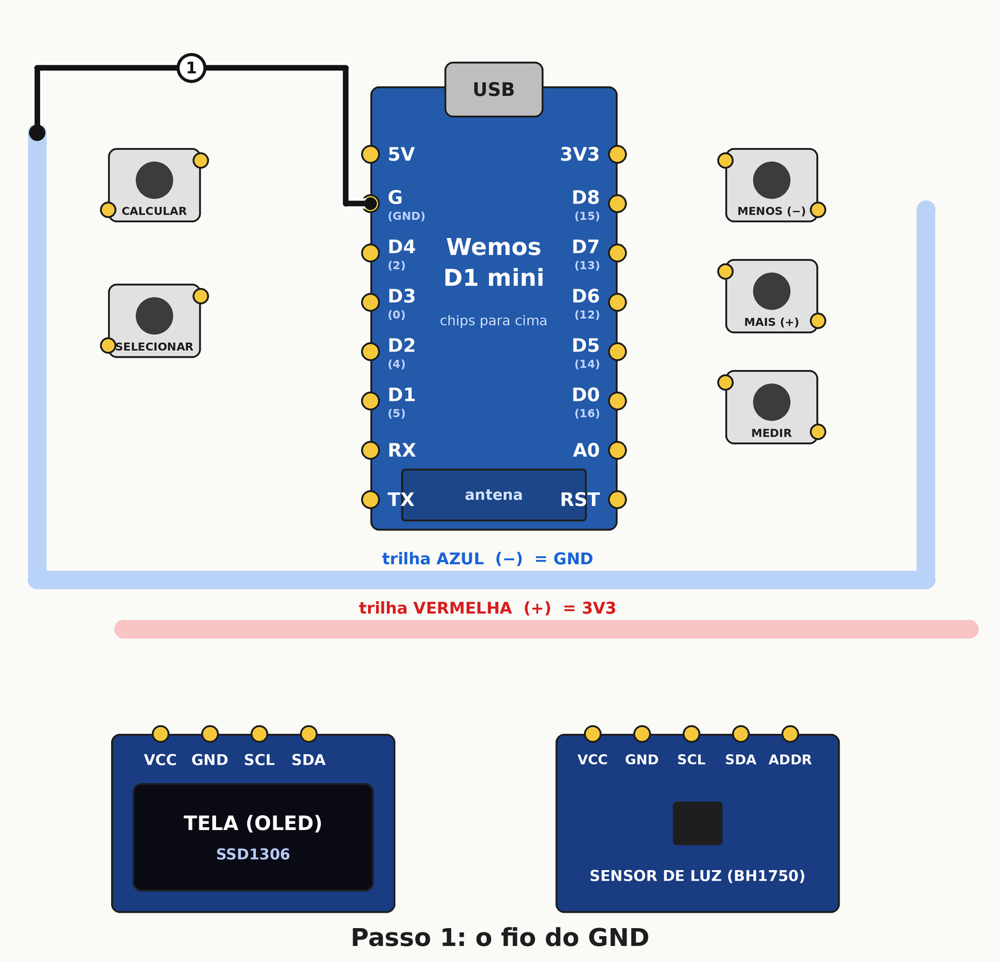

| Fio | Uma ponta no | Outra ponta no |
| :-: | ------------ | -------------- |
| 1 (preto) | pino **G** (GND) da placa | **trilha azul** |

- [ ] Pronto. Confira: é o **segundo** pino da esquerda. O primeiro é o 5V, **não use**.

## Passo 2: o fio da energia

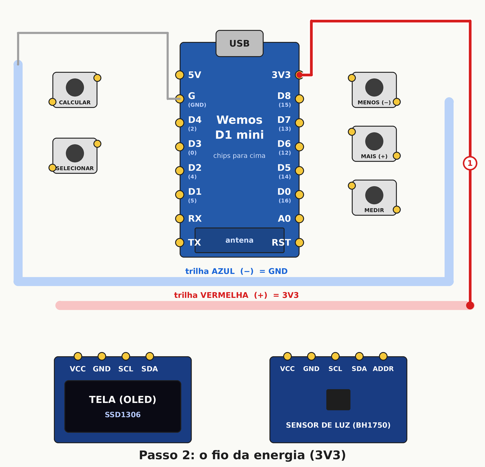

| Fio | Uma ponta no | Outra ponta na |
| :-: | ------------ | -------------- |
| 1 (vermelho) | pino **3V3** da placa | **trilha vermelha** |

- [ ] Pronto. É o **primeiro** pino da direita.

## Passo 3: a tela

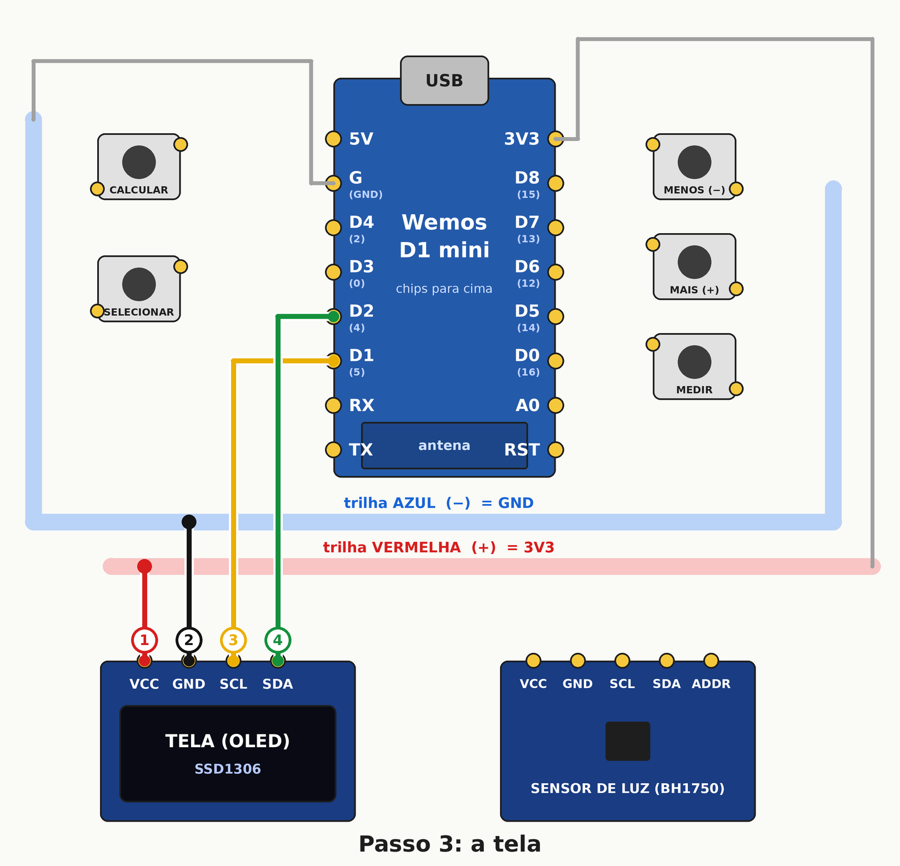

| Fio | Na tela | Liga em |
| :-: | ------- | ------- |
| 1 (vermelho) | **VCC** | trilha vermelha |
| 2 (preto) | **GND** | trilha azul |
| 3 (amarelo) | **SCL** | pino **D1** |
| 4 (verde) | **SDA** | pino **D2** |

- [ ] Pronto.

## Passo 4: o sensor de luz

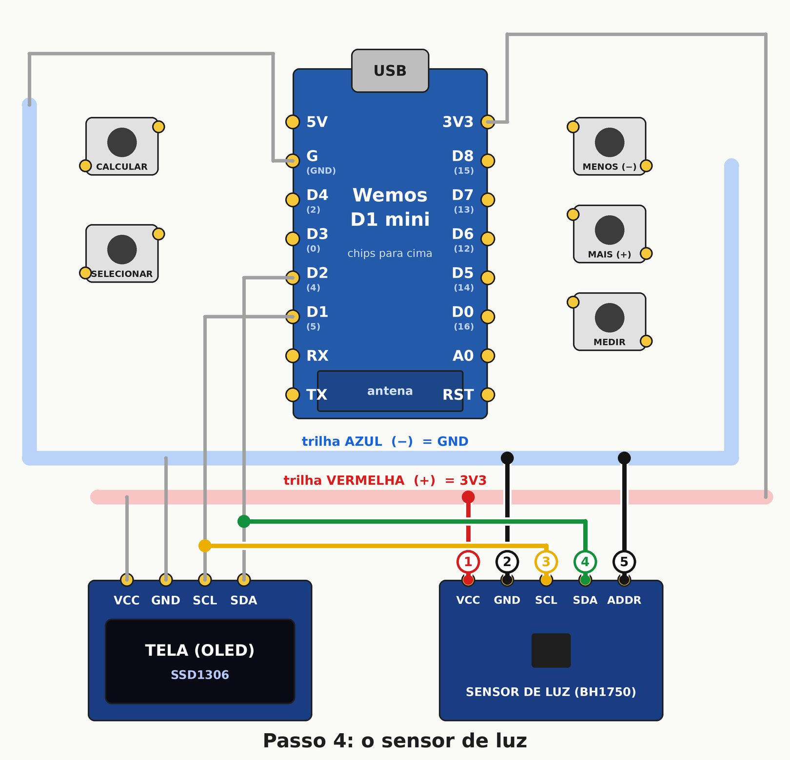

| Fio | No sensor | Liga em |
| :-: | --------- | ------- |
| 1 (vermelho) | **VCC** | trilha vermelha |
| 2 (preto) | **GND** | trilha azul |
| 3 (amarelo) | **SCL** | fileira do **SCL da tela** (ou do pino D1) |
| 4 (verde) | **SDA** | fileira do **SDA da tela** (ou do pino D2) |
| 5 (preto) | **ADDR** | trilha azul |

- [ ] Pronto.

## Passos 5 a 9: os botões

Cada botão usa **2 fios** e **2 pernas na diagonal**. Coloque o botão atravessado
no vão do meio. Ligue **um botão de cada vez**.

### Passo 5: MEDIR

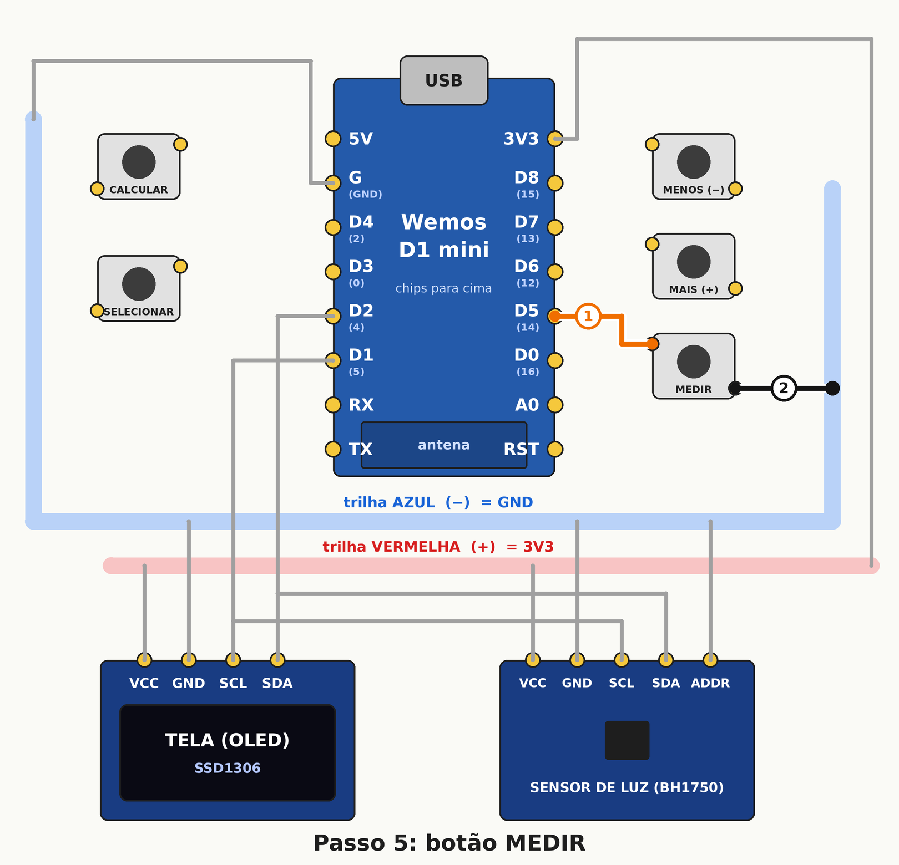

- [ ] Fio 1: pino **D5** até uma perna do botão.
- [ ] Fio 2: perna da diagonal até a **trilha azul**.

### Passo 6: MAIS (+)

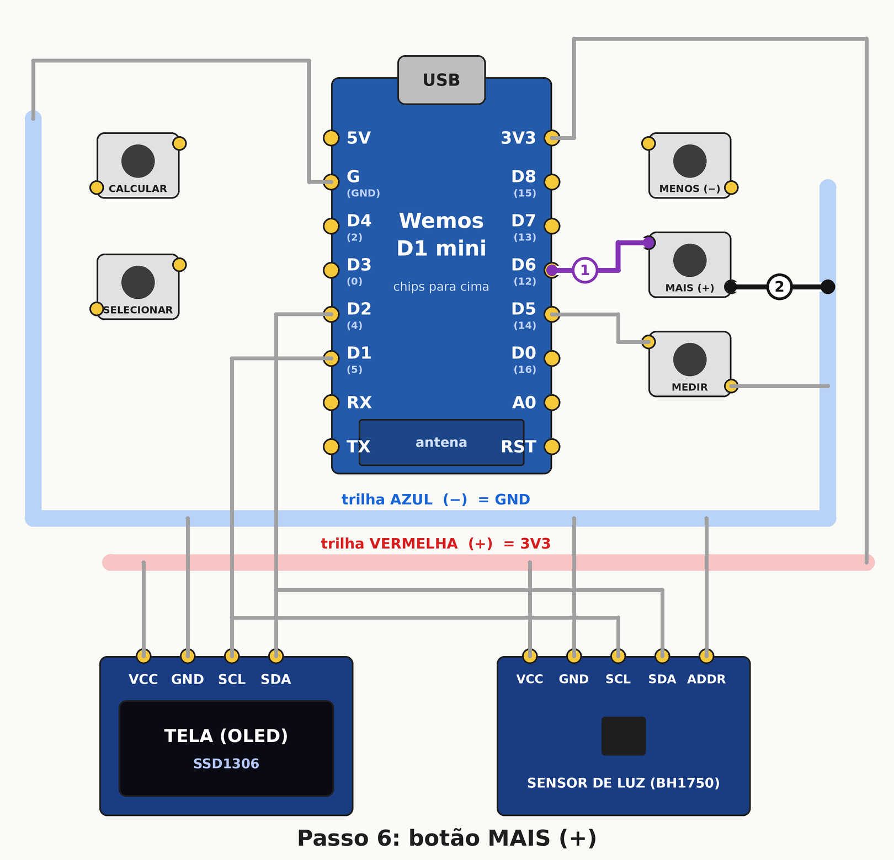

- [ ] Fio 1: pino **D6** até uma perna do botão.
- [ ] Fio 2: perna da diagonal até a **trilha azul**.

### Passo 7: MENOS (−)

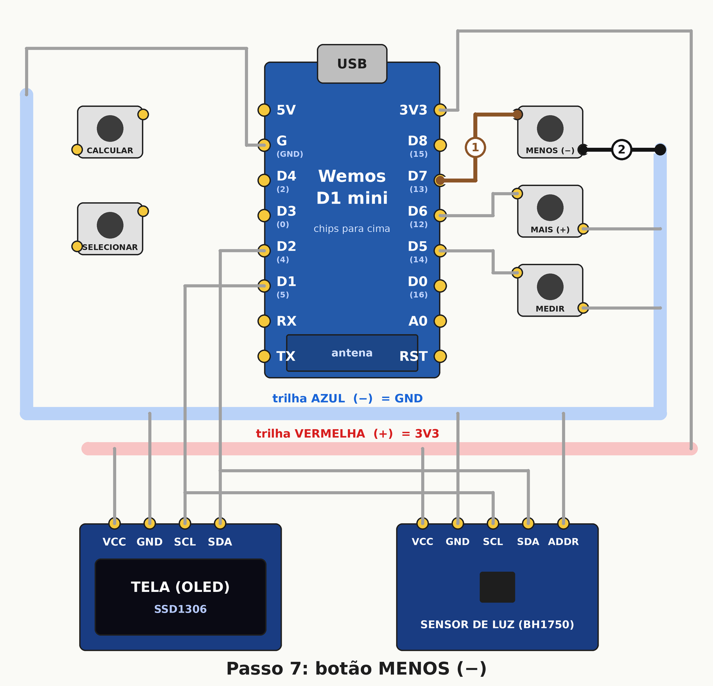

- [ ] Fio 1: pino **D7** até uma perna do botão.
- [ ] Fio 2: perna da diagonal até a **trilha azul**.

Atenção: o **D7 fica acima do D6**.

### Passo 8: SELECIONAR

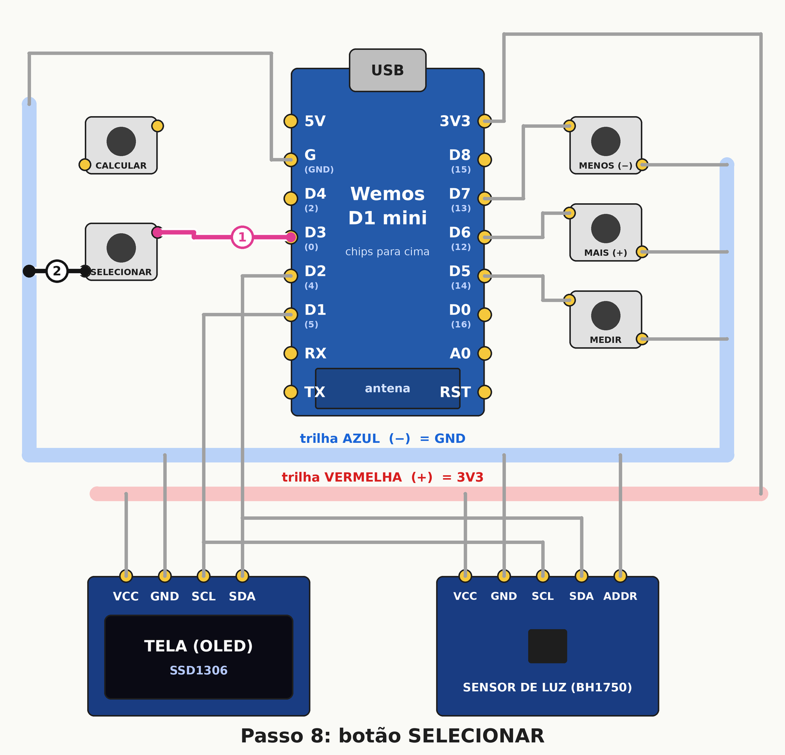

- [ ] Fio 1: pino **D3** até uma perna do botão.
- [ ] Fio 2: perna da diagonal até a **trilha azul**.

### Passo 9: CALCULAR

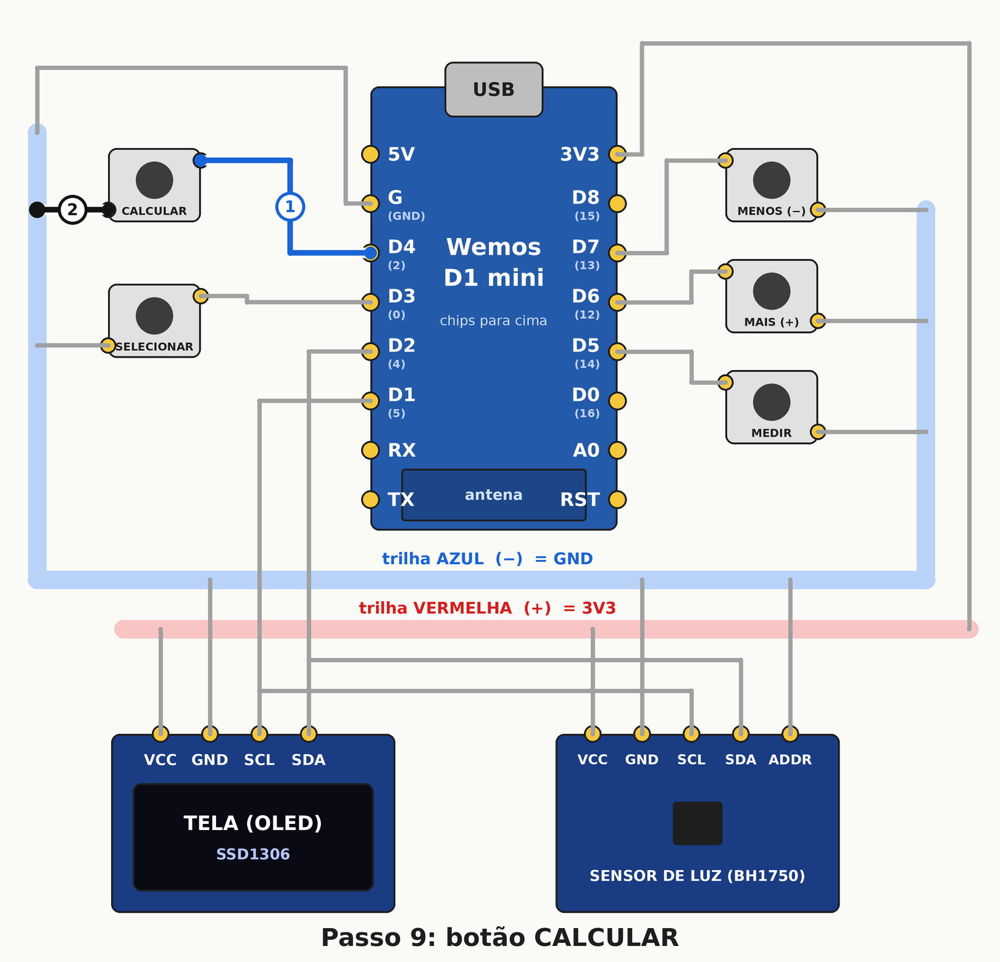

- [ ] Fio 1: pino **D4** até uma perna do botão.
- [ ] Fio 2: perna da diagonal até a **trilha azul**.

---

## Passo 10: conferir e ligar

Antes de plugar:

- [ ] Nenhum fio no **5V**, no **RX**, no **TX** nem no **RST**.
- [ ] Nenhum fio unindo a trilha azul com a vermelha.
- [ ] Não há pontas de metal encostando umas nas outras.

Plugue o USB **sem apertar nenhum botão**. A tela deve mostrar **Aperte MEDIR**.
(O programa precisa estar gravado na placa: veja o [README](../README.md#compilar-e-gravar).)

| Aperte | Deve acontecer |
| ------ | -------------- |
| MEDIR | aparecem a luz (`lx`), o `EV` e o resultado |
| MAIS e MENOS | muda o valor destacado (e a régua de baixo anda) |
| SELECIONAR | o destaque pula para o outro valor |
| CALCULAR | muda o que aparece grande no meio |

## Se não funcionar

Tire o USB primeiro.

| O que acontece | O que olhar |
| -------------- | ----------- |
| Tela apagada | fios dos passos 1 a 3; SCL e SDA trocados |
| Apagou depois de ligar um botão | último botão: fio no pino errado, ou azul ligado à vermelha |
| `Erro no sensor` | fios do passo 4 |
| Um botão não faz nada | pino certo? perna na diagonal? trilha azul ligada ao G? |
| Um botão age sozinho | gire o botão um quarto de volta |

Para achar o defeito, há dois programas de teste em [`tools/`](../tools/):
`i2c_scan` (tela e sensor) e `button_test` (botões).

---

## Depois: ligar uma bateria

> [!CAUTION]
> **Trabalho de adulto, e esta parte nunca foi montada nem testada.** Bateria de
> lítio ligada errado pode pegar fogo. Leia antes as
> [regras da parte de energia](../README.md#montagem-da-parte-de-energia).

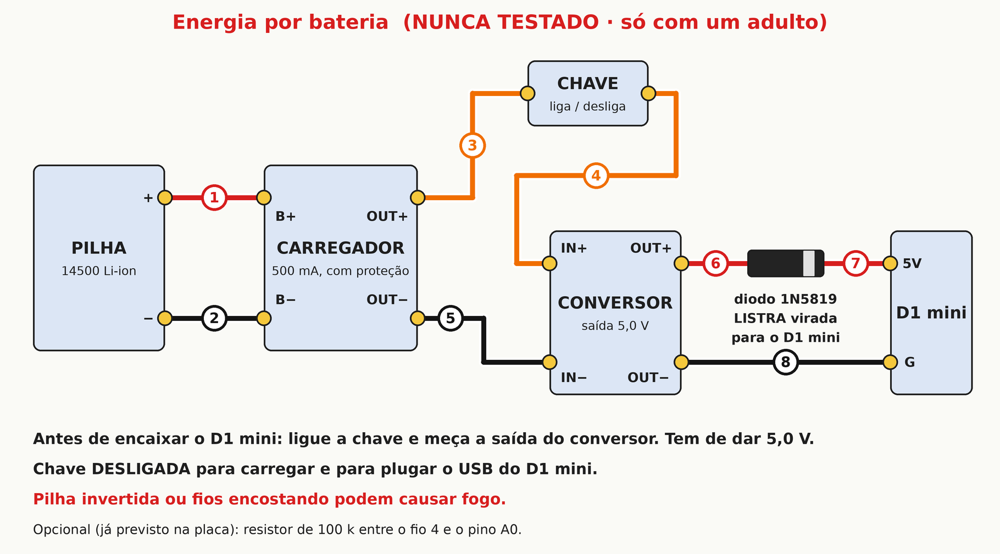

| Fio | De | Até |
| :-: | -- | --- |
| 1 | pilha **+** | carregador **B+** |
| 2 | pilha **−** | carregador **B−** |
| 3 | carregador **OUT+** | um lado da chave |
| 4 | outro lado da chave | conversor **IN+** |
| 5 | carregador **OUT−** | conversor **IN−** |
| 6 | conversor **OUT+** | perna do diodo **sem** listra |
| 7 | perna do diodo **com** listra | pino **5V** do D1 mini |
| 8 | conversor **OUT−** | pino **G** do D1 mini |

---

*Desenhos gerados por [`tools/diagramas/gerar.py`](../tools/diagramas/gerar.py),
que confere os pinos contra o firmware.*
