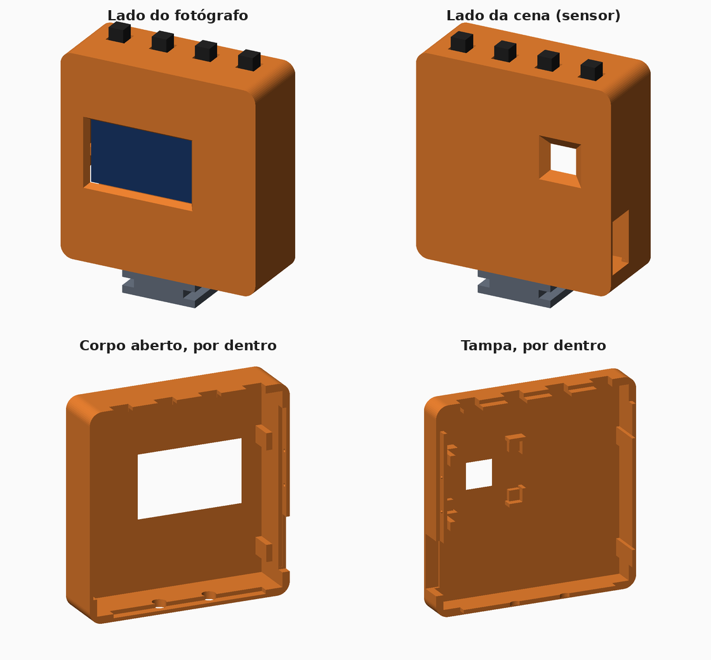
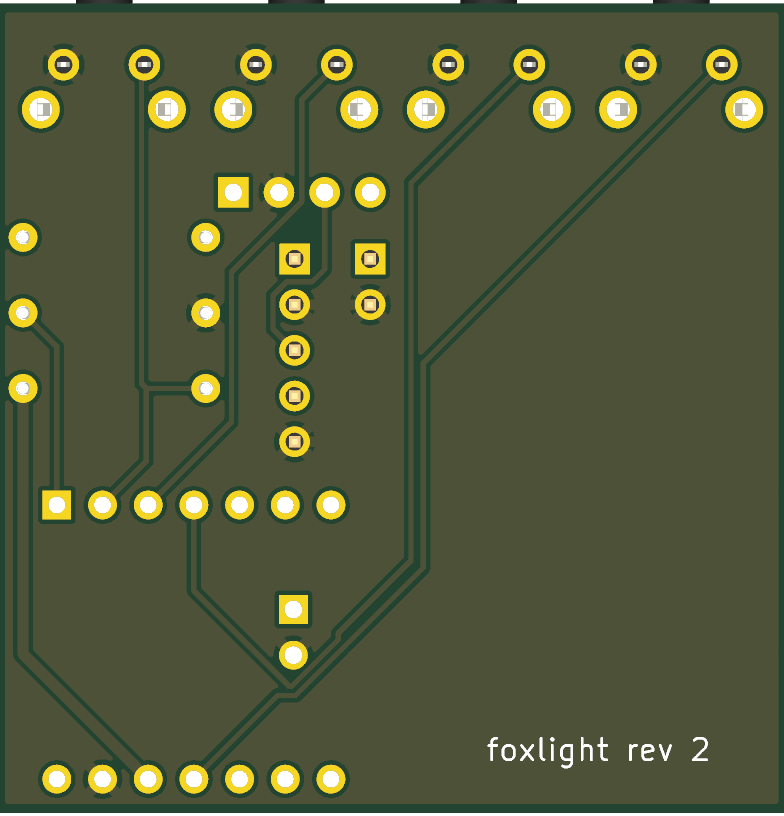

# Rev 2: fotômetro de sapata

Versão compacta, para encaixar na sapata fria da câmera. Tela voltada para o
fotógrafo, sensor voltado para a cena, quatro botões no topo, bateria carregada
por USB-C.



> [!WARNING]
> **Nada desta versão foi montado.** O firmware compila para a XIAO ESP32C6, mas
> nunca rodou nela. A placa passa no DRC, mas nunca foi fabricada. A caixa nunca
> foi impressa e usa várias [medidas estimadas](#medidas-a-conferir).

| Frente da placa (tela) | Verso (XIAO, bateria, botões) |
| :--------------------: | :---------------------------: |
|  |  |

Caixa: **48,3 × 49,3 × 18,6 mm** (largura, altura, profundidade), mais o pé.
Placa: 44 × 45 mm.

## Peças

| Qtd | Peça | Observação |
| --- | ---- | ---------- |
| 1 | Seeed XIAO ESP32C6 | com barras de pinos 2×7; já tem USB-C e carregador de 100 mA |
| 1 | OLED SSD1306 0,96" I2C, 4 pinos | |
| 1 | Sensor BH1750 (GY-302) | sem difusor |
| 1 | Bateria LiPo 3,7 V **com placa de proteção** | até 20 × 36 × 7,5 mm: 752035 (500 mAh) ou 502030 (250 mAh) |
| 4 | Botão tátil 6×6 mm **de 90°**, altura 9,5 mm, com abas | modelo do desenho: C&K PTS645, haste de 9,5 mm |
| 2 | Resistor 200 k, 1/4 W | R1, R2: medida da bateria |
| 1 | Resistor 100 k, 1/4 W | R3: mantém o botão Medir em repouso durante o sono |
| — | Barra de pinos, fios finos, termorretrátil, fita dupla face de espuma | |

## Cuidados com a bateria

Bateria de lítio perfurada, em curto ou ligada ao contrário pode pegar fogo.

- Compre célula **com placa de proteção (PCM)**. Muitas baterias de drone vêm
  sem. Pergunte ao vendedor antes de comprar.
- Meça a polaridade com o multímetro. Não confie na cor dos fios nem no conector.
- Se precisar cortar o conector, corte **um fio de cada vez**.
- A bateria não pode encostar em pontas de metal.
- Na primeira carga, fique por perto. Não carregue célula estufada ou quente.
- Não deixe o aparelho dentro de carro ao sol.

## Antes de soldar a placa

1. **Imprima a caixa e o pé** e teste na câmera: o aparelho não pode atrapalhar
   botões, alavancas nem o visor.
2. Imprima os moldes
   [da frente](../hardware/imagens/rev2_molde_frente_1x1.pdf) e
   [do verso](../hardware/imagens/rev2_molde_verso_1x1.pdf) em escala 100% e
   encoste as peças no papel.
3. Teste a XIAO na protoboard (abaixo).

## Teste na protoboard

| XIAO | Liga em |
| ---- | ------- |
| 3V3 | VCC da tela e do sensor |
| GND | GND da tela e do sensor, ADDR do sensor, um lado de cada botão |
| D4 | SDA da tela e do sensor |
| D5 | SCL da tela e do sensor |
| D1 | botão **Medir**, e um resistor de 100 k até o 3V3 |
| D2 | botão **+** |
| D3 | botão **−** |
| D10 | botão **Modo** |
| D0 | GND (sem bateria, esconde o ícone) |

## Gravar

```bash
URL=https://raw.githubusercontent.com/espressif/arduino-esp32/gh-pages/package_esp32_index.json
arduino-cli core install esp32:esp32 --additional-urls $URL
arduino-cli lib install "Adafruit GFX Library" "Adafruit SSD1306" BH1750
arduino-cli compile --fqbn esp32:esp32:XIAO_ESP32C6 src/foxlight
arduino-cli upload  --fqbn esp32:esp32:XIAO_ESP32C6 -p /dev/ttyACM0 src/foxlight
```

Dormindo, a porta USB some. Aperte **Medir** para acordar (ligada a um
computador, ela fica acordada). Se a gravação falhar, desligue a bateria, segure
**BOOT** na XIAO e ligue o cabo.

## Uso

| Botão | Toque | Segurando |
| ----- | ----- | --------- |
| Medir | mede (e acorda o aparelho) | medição contínua |
| + / − | muda o valor marcado com `>` em 1/3 de stop | repete |
| Modo | passa o `>` para o outro valor | troca a incógnita: tempo → abertura → ISO |

Depois de 60 s sem uso o aparelho dorme. O ícone no canto superior direito
mostra a carga aproximada.

## Montagem

Lados: **frente** é o da tela, **verso** é o da XIAO. Solde e corte cada ponta
rente (menos de 2 mm). A tela vai por último porque cobre as outras soldas.
**Sem bateria até o passo 9.**

1. R1, R2 (200 k) e R3 (100 k) pelo verso.
2. Os quatro botões pelo verso, bem assentados, com as hastes para fora da borda
   de cima.
3. Na XIAO, solde um pedaço de terminal de resistor em cada **pad de bateria**
   (embaixo dela): positivo no lado marcado D5, negativo no lado marcado D8.
   Deixe os dois retos, para baixo. Depois solde as barras de pinos.
4. Encaixe a XIAO pelo verso, USB para o lado marcado `USB`. Os dois terminais
   passam pelos furos `B+` e `B−`. Solde pela frente.
5. Sensor: cinco fios de uns 5 cm nos furos `3V3 GND SCL SDA ADR`, e as outras
   pontas no GY-302, na mesma ordem.
6. Dois pinos de barra nos furos `B+` e `B−` ao lado dos fios do sensor.
7. Tela pela frente, soldada pelo verso.
8. Sem bateria, ligue o USB e teste tela, sensor e botões.
9. Desligue o USB. Confira com o multímetro que não há curto entre `B+` e `B−`.
   Solde os fios da bateria nos dois pinos, **um de cada vez**, e cubra cada um
   com termorretrátil antes de pegar o outro.
10. Fixe a bateria com fita de espuma na área marcada do verso.
11. Assente o sensor no berço da tampa, chip dentro da abertura. Um ponto de cola
    quente na borda, longe do chip.
12. Coloque a placa no corpo (tela na janela), feche a tampa e cole o pé embaixo.

## Imprimir a caixa

| Arquivo | Peça |
| ------- | ---- |
| [`caixa_corpo.stl`](../hardware/caixa/caixa_corpo.stl) | lado da tela |
| [`caixa_tampa.stl`](../hardware/caixa/caixa_tampa.stl) | lado do sensor |
| [`pe_sapata.stl`](../hardware/caixa/pe_sapata.stl) | pé para a sapata |

- Sugestão: PETG opaco, de preferência preto, camada de 0,2 mm. PLA amolece no
  sol.
- Os arquivos já saem na posição de impressão.
- O pé é de plástico de propósito: pé de metal pode curto-circuitar os contatos
  de uma sapata com flash.
- A tampa fecha por pressão. Se ficar frouxa, uma volta de fita resolve.

Para mudar medidas, edite o topo de
[`tools/caixa/gerar.py`](../tools/caixa/gerar.py) e rode:

```bash
pip install manifold3d numpy pillow
python3 tools/caixa/gerar.py
```

O script acusa se a caixa invadir o volume de alguma peça.

## Medidas a conferir

| Medida | Valor usado | Onde mudar |
| ------ | ----------- | ---------- |
| Contorno e furos da tela | 27,3 × 27,8 mm | footprint e `componentes()` |
| Janela da tela | 25 × 15 mm | `JANELA_TELA` |
| GY-302 e posição do chip | 18,5 × 13,9 mm, chip no centro | `SENSOR_MODULO`, `SENSOR_CHIP` |
| Altura da haste dos botões | 3,6 mm acima da placa | `BOTAO_EIXO_Z` |
| Pé da sapata | aba 18 × 18 × 1,8 mm | `PE_*` |
| Altura da XIAO com barras de pinos | 6,9 mm | `componentes()` |
| LED de carga | sem furo próprio: ver se aparece pela abertura do USB | `aberturas()` |

Calibre com o sensor **já dentro da caixa** (ver
[Calibração](../README.md#calibração)).

## Placa

Projeto KiCad em [`hardware/kicad_rev2/`](../hardware/kicad_rev2/), dupla face,
só componentes THT. Gerbers em
[`foxlight_rev2_gerbers.zip`](../hardware/foxlight_rev2_gerbers.zip).


