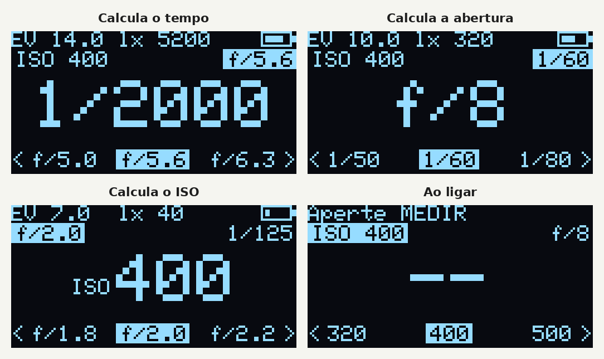
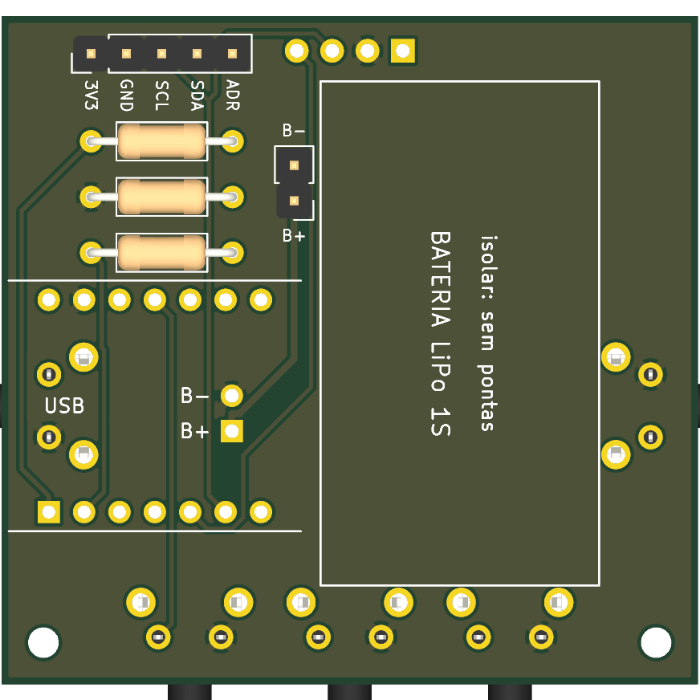
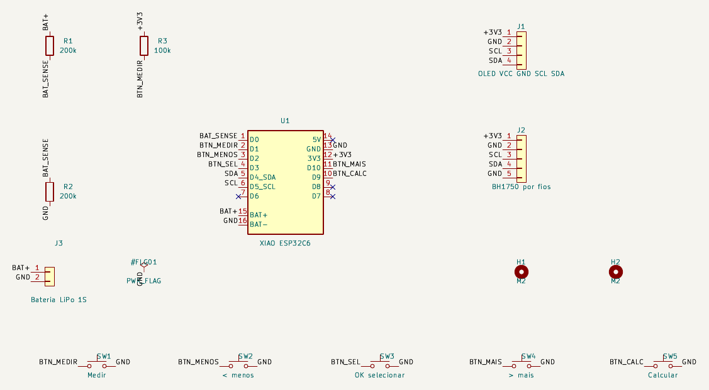

# Rev 2: fotômetro de sapata

Versão compacta, deitada sobre a sapata da câmera: tela virada para cima, sensor
virado para a cena, `◄` `OK` `►` atrás, **Medir** à esquerda, **Calcular** e
USB-C à direita. Bateria carregada por USB-C.


> [!WARNING]
> **Nada desta versão foi montado.** O firmware compila para a XIAO ESP32C6, mas
> nunca rodou nela. A placa passa no DRC, mas nunca foi fabricada. A caixa nunca
> foi impressa e usa várias [medidas estimadas](#medidas-a-conferir).

## Tela



*Desenhadas no PC pelo mesmo código do firmware.*

De cima para baixo: EV, lux e bateria; os dois valores que você definiu (o que
está sendo mudado aparece destacado); o resultado em letras grandes; e a régua do
valor destacado, com o anterior e o próximo.

## Uso

| Botão | Toque | Segurando |
| ----- | ----- | --------- |
| Medir | mede (e acorda o aparelho) | medição contínua |
| ◄ / ► | muda o valor destacado em 1/3 de stop | repete |
| OK | passa o destaque para o outro valor | — |
| Calcular | troca a incógnita: tempo → abertura → ISO | — |

Depois de 60 s sem uso o aparelho dorme.

## Peças

| Qtd | Peça | Observação |
| --- | ---- | ---------- |
| 1 | Seeed XIAO ESP32C6 | com barras de pinos 2×7; já tem USB-C e carregador de 100 mA |
| 1 | OLED SSD1306 0,96" I2C, 4 pinos | |
| 1 | Sensor BH1750 (GY-302) | sem difusor |
| 1 | Bateria LiPo 3,7 V **com placa de proteção** | até 20 × 36 × 7,5 mm: 752035 (500 mAh) ou 502030 (250 mAh) |
| 5 | Botão tátil 6×6 mm **de 90°**, altura 9,5 mm, com abas | modelo do desenho: C&K PTS645, haste de 9,5 mm |
| 2 | Resistor 200 k, 1/4 W | R1, R2: medida da bateria |
| 1 | Resistor 100 k, 1/4 W | R3: mantém o botão Medir em repouso durante o sono |
| 4 | Parafuso M2 × 14 mm, cabeça de até 4 mm | rosqueiam direto no plástico |
| — | Barra de pinos, fios finos, termorretrátil, fita de espuma, fita isolante térmica | |

Para o pé, uma das opções:

- **Impresso:** `pe_sapata.stl`, colado sob a caixa. Mais baixo e sem metal.
- **Com trava:** imprima `pe_porca_1-4.stl`, encaixe uma porca 1/4"-20, cole sob
  a caixa e rosqueie um adaptador de sapata com porca de aperto, comprado pronto.
  Base de metal pode curto-circuitar os contatos de uma sapata com flash: prefira
  base de plástico ou isole o contato com fita.

## Cuidados com a bateria

Bateria de lítio perfurada, em curto ou ligada ao contrário pode pegar fogo.

- Compre célula **com placa de proteção (PCM)**. Muitas baterias de drone vêm
  sem. Pergunte ao vendedor antes de comprar.
- Meça a polaridade com o multímetro. Não confie na cor dos fios nem no conector.
- Se precisar cortar o conector, corte **um fio de cada vez**.
- A bateria não pode encostar em pontas de metal.
- Na primeira carga, fique por perto. Não carregue célula estufada ou quente.
- Não deixe o aparelho dentro de carro ao sol.

## Antes de soldar a placa

1. **Imprima a caixa e o pé** e teste na câmera: o aparelho não pode atrapalhar
   botões e alavancas, nem bater na sua testa quando você olha no visor.
2. Imprima os moldes
   [de cima](../hardware/imagens/rev2_molde_frente_1x1.pdf) e
   [de baixo](../hardware/imagens/rev2_molde_verso_1x1.pdf) em escala 100% e
   encoste as peças no papel.
3. Teste a XIAO na protoboard (abaixo).

## Teste na protoboard

| XIAO | Liga em |
| ---- | ------- |
| 3V3 | VCC da tela e do sensor |
| GND | GND da tela e do sensor, ADDR do sensor, um lado de cada botão |
| D4 | SDA da tela e do sensor |
| D5 | SCL da tela e do sensor |
| D1 | botão **Medir**, e um resistor de 100 k até o 3V3 |
| D2 | botão **◄** |
| D3 | botão **OK** |
| D10 | botão **►** |
| D9 | botão **Calcular** |
| D0 | GND (sem bateria, esconde o ícone) |

A tela e os botões novos também funcionam na montagem com a D1 mini do
[guia](MONTAGEM.md): ◄ é MENOS, ► é MAIS e OK é SELECIONAR.

## Gravar

```bash
URL=https://raw.githubusercontent.com/espressif/arduino-esp32/gh-pages/package_esp32_index.json
arduino-cli core install esp32:esp32 --additional-urls $URL
arduino-cli lib install "Adafruit GFX Library" "Adafruit SSD1306" BH1750
arduino-cli compile --fqbn esp32:esp32:XIAO_ESP32C6 src/foxlight
arduino-cli upload  --fqbn esp32:esp32:XIAO_ESP32C6 -p /dev/ttyACM0 src/foxlight
```

Dormindo, a porta USB some. Aperte **Medir** para acordar (ligada a um
computador, ela fica acordada). Se a gravação falhar, desligue a bateria, segure
**BOOT** na XIAO e ligue o cabo.

## Placa

50 × 48 mm, dupla face, só componentes THT. Projeto KiCad em
[`hardware/kicad_rev2/`](../hardware/kicad_rev2/) e gerbers em
[`foxlight_rev2_gerbers.zip`](../hardware/foxlight_rev2_gerbers.zip).

| Em cima (tela e botões) | Embaixo (XIAO e bateria) |
| :---------------------: | :----------------------: |
|  |  |

*Imagens geradas pelo KiCad; a tela e a XIAO não aparecem.*



## Montagem

**Em cima** é o lado da tela, **embaixo** é o da XIAO. Solde e corte cada ponta
rente (menos de 1,5 mm). A tela vai por último porque cobre outras soldas.
**Sem bateria até o passo 9.**

1. R1, R2 (200 k) e R3 (100 k) por baixo.
2. Sensor: cinco fios de uns 5 cm nos furos `3V3 GND SCL SDA ADR`, e as outras
   pontas no GY-302, na mesma ordem. Dois pinos de barra nos furos `B+` e `B−`,
   também por baixo.
3. Os cinco botões por cima, bem assentados, com as hastes para fora das bordas.
4. Cubra com fita isolante térmica as soldas do botão Calcular, embaixo: a XIAO
   fica sobre elas.
5. Na XIAO, solde um pedaço de terminal de resistor em cada **pad de bateria**
   (embaixo dela): positivo no lado marcado D5, negativo no lado marcado D8.
   Deixe os dois retos, para baixo. Depois solde as barras de pinos.
6. Encaixe a XIAO por baixo, USB para o lado marcado `USB`. Os dois terminais
   passam pelos furos `B+` e `B−` sob ela. Solde por cima.
7. Tela por cima, soldada por baixo.
8. Sem bateria, ligue o USB e teste tela, sensor e botões.
9. Desligue o USB. Confira com o multímetro que não há curto entre `B+` e `B−`.
   Solde os fios da bateria nos dois pinos, **um de cada vez**, e cubra cada um
   com termorretrátil antes de pegar o outro.
10. Fixe a bateria com fita de espuma na área marcada.
11. Deslize o sensor entre os trilhos da base, chip virado para a abertura. Um
    ponto de cola quente na borda, longe do chip.
12. Desça a placa reta dentro da base: as hastes entram nos rasgos e o conector
    USB no canal da parede.
13. Coloque a tampa, aperte os quatro parafusos por baixo, sem forçar, e cole o
    pé.

## Imprimir a caixa

Medidas: **54,3 × 58,5 × 20,4 mm** (largura, profundidade, altura), mais 2,5 mm
da moldura do sensor e o pé.

| Arquivo | Peça |
| ------- | ---- |
| [`caixa_base.stl`](../hardware/caixa/caixa_base.stl) | base, com o berço do sensor |
| [`caixa_tampa.stl`](../hardware/caixa/caixa_tampa.stl) | tampa, com a janela da tela |
| [`pe_sapata.stl`](../hardware/caixa/pe_sapata.stl) | pé de sapata impresso |
| [`pe_porca_1-4.stl`](../hardware/caixa/pe_porca_1-4.stl) | base para porca 1/4"-20 |

- Sugestão: PETG opaco, de preferência preto, camada de 0,2 mm. PLA amolece no
  sol.
- Os arquivos já saem na posição de impressão. A base pede um pequeno suporte
  sob a moldura do sensor.

Para mudar medidas, edite o topo de
[`tools/caixa/gerar.py`](../tools/caixa/gerar.py) e rode:

```bash
pip install manifold3d numpy pillow matplotlib
python3 tools/caixa/gerar.py
```

O script acusa se a caixa invadir o volume de alguma peça.

## Medidas a conferir

| Medida | Valor usado | Onde mudar |
| ------ | ----------- | ---------- |
| Contorno e furos da tela | 27,3 × 27,8 mm | footprint e `componentes()` |
| Janela da tela | 25 × 15 mm | `JANELA_TELA` |
| GY-302 e posição do chip | 18,5 × 13,9 mm, chip no centro | `SENSOR_X`, `SENSOR_Z`, `SENSOR_CHIP` |
| Botões comprados | iguais ao modelo C&K do KiCad | footprint e `BOTAO_*` |
| Pé da sapata | aba 18 × 18 × 1,8 mm | `PE_*` |
| Altura da XIAO com barras de pinos | 6,9 mm | `componentes()` |
| LED de carga | sem furo próprio: ver se aparece pela abertura do USB | `aberturas()` |

A moldura do sensor estreita um pouco o campo de visão. Calibre com o sensor
**já dentro da caixa** (ver [Calibração](../README.md#calibração)).
